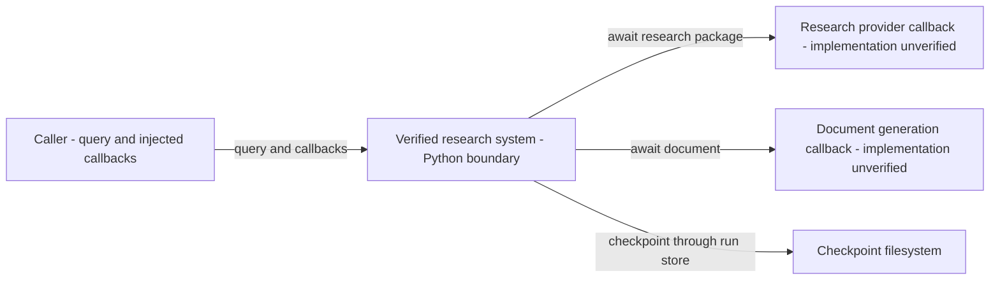

# Basefive R14 — C4 Level 1: System Context

Status: CANDIDATE / UNACCEPTED · 2026-10-14

FACT: Target is `af-deep-research`, not the canonical BMad workflow repository. This view covers the inspected Python verified-research boundary, not all services in the checkout. Node IDs, labels, edges, evidence anchors and source SHA-256 identities are defined in `basefive-r14-contracts.json`; the adjacent Node test checks them against current files.

## Boundaries and Evidence

- FACT: `verified_pipeline.py` declares `execute_verified_pipeline` with injected async research/generation callbacks and a required `upstream_kwargs` mapping. This is a Python API, not evidence of an HTTP route or deployed service.
- FACT: Research packages can be reused from checkpoint payloads; generation is skipped for programmatic partial abstention. The arrows show permitted static interactions, not unconditional calls on every branch.
- FACT: `ResearchRunStore` loads JSON and saves through a temporary file, flush, file fsync and `os.replace`. This does not by itself prove directory durability, distributed atomicity or concurrent-writer safety.
- ASSUMPTION: A caller supplies compatible callback implementations. Their implementations, provider/network topology, deployment, and credential handling are outside the permitted source slice.
- FACT: No live task/lease/terminal state is changed. Product acceptance and native failure/restart E2E remain independent gates under `../acceptance/c4-releasegate-reducer-frontier-20261013.md`.

## Drill Down

Level 2 is `basefive-r14-container.mmd`; Level 3 is `basefive-r14-component.mmd`. Containers are explicitly logical runtime/storage boundaries: inspected modules do not establish independently deployed processes. The in-memory report adapter is not drawn as persistent disk storage. Disconnected grounded-report/resume components deliberately avoid inventing calls from the orchestrator.

## Reproducible Check

`node --test docs/architecture/basefive-r14-contract.test.mjs`

The check uses Node built-ins only: exact source fingerprints, Python declaration snapshots, inventory comparison, restricted Mermaid node/edge validation, and negative mutations. It neither executes Python nor renders Mermaid. Runtime verification and independent acceptance are not implied by a green static contract suite.
